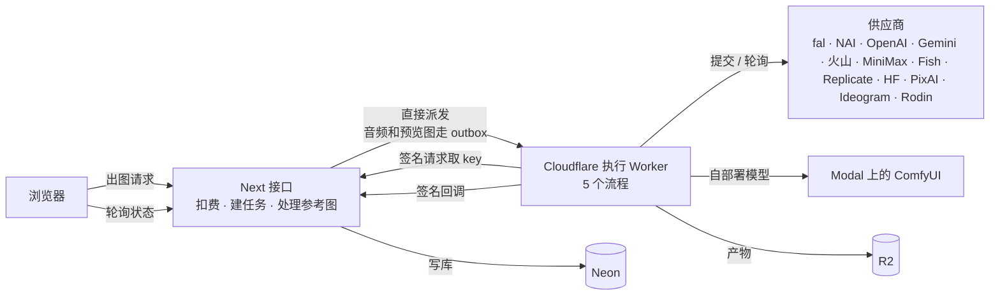

# Worker 整体设计

施工单 `o-worker`（含 `g-outbox`）。2026-10-21 出稿，基线 main b0d05df；原稿 https://claude.ai/artifact/1mifXpHSb2GK7Cj8jemoNW （云端，已停更，以本文为准）。

## 已定

- 10-21 owner：按这个方向做；第 1–3 步提前到 bug 之后做。
- 第 1 步（删 RunPod）#312 已完成。
- 「按账号排队」10-23 由助手第 5a 步 #351 先做掉了，做法和原稿不同：不是 Durable Object，而是 Worker 解析完 key 后问应用侧 `POST /api/internal/execution/slot`（`execution-slot.service`，占位存在 `GenerationJob.slotKey / slotAcquiredAt`，并发表 `IMAGE_ACCOUNT_CONCURRENCY`）。现行做法见 `references/backend.md`「按账号排队」。第 3 步剩「驱动接口 + 共用契约」。

## 一句话结论

所有生成（图、视频、音频、3D）都走 Cloudflare 执行 Worker，路线是对的；问题在 Worker 内部：`workers/execution/src/index.ts` 一个文件（10-21 是 9453 行，10-29 是 8452 行）装了 12 家以上供应商、5 个流程和所有公共逻辑，同一件事写了好几份。改成「一家供应商一个驱动 + 一个通用生成流程 + 一份两边共用的契约」，分 7 步，每步能单独上线和回滚。

> 更正：视频 / 3D 也是 Worker 跑完后签名回调写库，关页不丢（体检报告曾误写为前端轮询会丢）。原第 5 批因此改成「统一派发」，并入本设计。

## 现在怎么跑

## 问题

| #   | 问题                       | 证据（10-21）                                                                                       | 后果                                                                  |
| --- | -------------------------- | --------------------------------------------------------------------------------------------------- | --------------------------------------------------------------------- |
| 1   | 一个文件装下所有东西       | 签名、加密、取 key、12+ 家提交与轮询、5 个流程、取消、日志全在 `index.ts`                           | 改一家得通读全文，测试只能整体跑                                      |
| 2   | 同一件事写多份             | 取 key 4 份，产物下载上传 R2 7 份，回调 3 份                                                        | 修一处漏一处                                                          |
| 3   | 图片流程是一个大分支       | `ImageQueueWorkflow.run` 约 600 行按供应商 if/else                                                  | 加一家要改主流程                                                      |
| 4   | ~~没有按账号排队~~         | 已由 #351 解决                                                                                      | —                                                                     |
| 5   | 两边名单靠注释同步         | Next 侧 `WORKER_MIGRATED_IMAGE_ADAPTERS`、`WORKER_CAPABLE_VIDEO_ADAPTERS`，注释写「只加一边会 500」 | 漏同步就线上 500                                                      |
| 6   | 派发有两条路               | 音频和预览图走 outbox，图片和视频直接派发                                                           | 「派发结果未知」要专门处理，两套补救                                  |
| 7   | ~~RunPod 旧分支~~          | 已由 #312 删除                                                                                      | —                                                                     |
| 8   | 出图入口在函数里处理参考图 | `/api/studio/generate` 内存不足 / 超时                                                              | 10-22 查实是 LoRA 整个读进内存，#324 已改边下边传；参考图直传仍值得做 |
| 9   | 看不到 Worker 自己的日志   | 10-23 起有 `CLOUDFLARE_API_TOKEN`，可查 telemetry（读线上日志前先问 owner）                         | 可观测还没进代码                                                      |

## 方案

1. **一家供应商一个驱动**：`providers/<名字>/` 只放请求构造、驱动、测试。驱动接口：`capabilities`（图 / 视频 / 音频 / 3D）、`submit`（同步出图直接返回结果）、`poll`、`cancel`、`classifyError`（翻成统一错误码，接 `o-errors`）、`concurrency`（每账号并发，NAI = 1）。
2. **一个通用生成流程**：5 个流程合成一个：取 key → 排队拿名额 → 提交 → 轮询或直接拿结果 → 存 R2 → 回调。长视频管线只编排多段，每段复用它。重试、超时、取消、回调只有一份。
3. **按账号排队**：已做（见上）。
4. **两边共用一份契约**：新建 `packages/execution-contract`：派发参数 Zod schema、回调结构、错误码、供应商能力清单。Next 和 Worker 都从这里导入；Next 侧「能不能走 Worker」直接读能力清单。
5. **派发只走一条路**：所有生成任务在建任务的同一事务里写 outbox 再派发，失败由 sweeper 补发，删掉「派发结果未知」分支。
6. **参考图直传**：浏览器用预签名地址直传 R2，Next 只收地址；要缩图的放到 Worker 做。
7. **看得见**：runId 从 Next 贯穿 Worker 和供应商；每步结构化日志。

ComfyUI：Modal 上的 ComfyUI 只是一个驱动（runner）。`workflow-builder` 等收进这个驱动的目录，之后 `o-comfy` 只动这一个目录。

## 分步

1. ~~删 RunPod 旧分支~~（#312）
2. 抽公共层：取 key、上传、回调、签名合成一份。只搬代码，不改行为。
3. 定驱动接口和共用契约，先把 NAI 迁成驱动。
4. 其余图片供应商逐家迁移，图片流程变成通用流程。
5. 视频、音频、3D 迁入通用流程；旧流程等在跑的实例结束后再下线（Cloudflare Workflow 实例跑完才能删类）。
6. 派发统一走 outbox，参考图改直传。
7. 补可观测和契约测试（每家录一份真实响应）。

## 做完的好处

- 加一家：加一个目录、清单注册一行，两边自动同步。
- 改一家：只看那一家的目录，测试只跑那一家。
- 取 key、上传、回调各剩一份，修一次全生效。
- 图、视频、音频、3D 共用重试、取消、回调和错误码，错误显示可以统一。
- 出问题能直接看到是哪一步、哪家、哪个账号。
